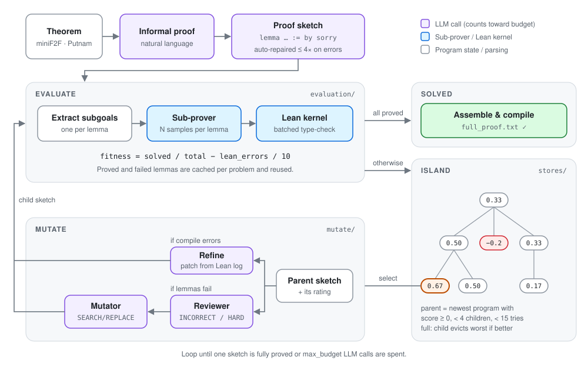
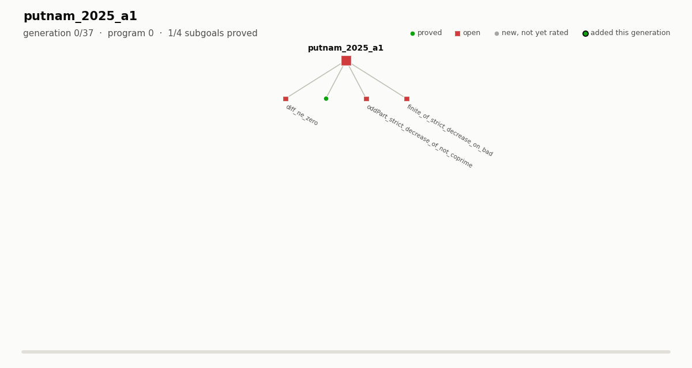

# lean_evolve

The goal of this project is to generate formal proofs, in Lean 4, of
high-school and college competition problems (miniF2F, Putnam). The hard part
is **autoformalization**: turning a natural-language proof into Lean that
compiles is far from easy.

lean_evolve starts from a natural-language proof written by an LLM and turns it
into a state: a **lemma-style Lean sketch**, where the main theorem chains
auxiliary `lemma`s left as `sorry`. A low-level prover then tries to close each
lemma. In each mutation round, a state is selected from the database, mutated,
evaluated, and stored back.

With this, we solved Putnam 2025 A1 and B3 and four IMO problems from miniF2F.

<p align="center"></p>

## Results

Budget = LLM calls per problem (informal proof, sketch, repair, reviewer,
mutator, assembly). Sub-prover samples and Lean checks are not counted.

| Benchmark | Solved | LLM calls per solved problem |
|---|:-:|---|
| miniF2F-test subset (`data/minif2f_s1.jsonl`) | **10 / 15** | 4 – 322 |
| ↳ IMO + IMO Shortlist problems | **4 / 7** | 29, 55, 103, 322 |
| Putnam 2025 (`data/putnam_s1.jsonl`) | **2 / 3** | A1: 234, B3: 298 |

<details>
<summary>Per-problem breakdown</summary>

| Problem | Solved | LLM calls |
|---|:-:|--:|
| amc12b_2021_p3 | ✓ | 4 |
| mathd_algebra_459 | ✓ | 4 |
| induction_nfactltnexpnm1ngt3 | ✓ | 9 |
| amc12a_2020_p10 | ✓ | 13 |
| induction_sumkexp3eqsumksq | ✓ | 22 |
| imo_1963_p5 | ✓ | 29 |
| imo_1992_p1 | ✓ | 55 |
| imo_1969_p2 | ✓ | 103 |
| mathd_algebra_320 | ✓ | 141 |
| imo_1982_p1 | ✓ | 322 |
| imo_1977_p6 | ✗ | |
| imo_1997_p5 | ✗ | |
| imosl_2007_algebra_p6 | ✗ | |
| algebra_apbmpcneq0_aeq0anbeq0anceq0 | ✗ | |
| numbertheory_fxeq4powxp6powxp9powx_f2powmdvdf2pown | ✗ | |
| putnam_2025_a1 | ✓ | 234 |
| putnam_2025_b3 | ✓ | 298 |
| putnam_2025_a2 | ✗ | |

</details>

Putnam 2025 A1, one frame per generation along the lineage of the solving
sketch (green = proved, red = open):

<p align="center"></p>

## Method

1. **Sketch.** An LLM writes an informal proof, then a Lean sketch: subgoal
   lemmas with `by sorry` and a main theorem that composes them without
   `sorry`. Sketches that fail to compile are repaired from the error log (up
   to `max_refine = 4` times).
2. **Prove subgoals.** Each subgoal (`evaluation/extractor.py`) is sampled
   `N_prover` times from an external prover (`INFERENCE_URL`) and checked in
   batches by a Lean server (`Evaluation_url`). Proofs and permanent failures
   are cached in `results/db/` and `results/db_failure/`.
3. **Fitness.** `succeeded / total − n_lean_errors / 10`. Once every subgoal is
   proved, the proofs are assembled and the full theorem is compiled.
4. **Mutate** (`mutate/program.py`). Compile errors → `refine`: one
   search/replace patch from the error log. Clean compile but failing subgoals
   → `decompose_reviewer`: a reviewer tags each failure `INCORRECT` (sketch is
   wrong) or `HARD` (prover can't close it), the feedback is compressed, and a
   mutator emits `SEARCH/REPLACE` edits that produce a child sketch.
5. **Population.** Islands of programs that share an informal-proof seed.
   Samplers: random, top-k, UCB1 (default), Shinka-style. `Pipeline.run()`
   walks newest-first and only mutates parents with positive score, < 15
   attempts and < 4 surviving children. A full island evicts its worst program.
6. **Budget.** Every OpenAI call increments `GLOBAL_LLM_CALLS`. The run halts
   at `max_budget`.

## Layout

```
lean_evolve/
├── __main__.py      # entry point: process_problem(...)
├── pipeline/        # evolutionary loop
├── stores/          # Database / Island / Program persistence, prompts, prover cache
├── mutate/          # refine / decompose_reviewer mutators
├── evaluation/      # subgoal extraction, prover calls, Lean verifier, scoring
└── models/          # OpenAI wrapper + GLOBAL_LLM_CALLS
scripts/proof_gif.py # animate a run's lemma tree (GIF above)
```

## Running

```bash
python -m lean_evolve        # problem and output dir are set at the bottom of __main__.py
python scripts/proof_gif.py results/island_0 -o docs/putnam_2025_a1.gif
```

| Env var | Used for |
|---|---|
| `OPEN_AI_KEY` | OpenAI (`gpt-5-mini`, `gpt-5.2`): sketch, repair, review, mutate |
| `INFERENCE_URL` | prover server: `{inputs: [...], pass_n: N}` → N candidates per input |
| `Evaluation_url` | `Lean4Client` verifier (sibling repo, `client.client`) |

Each program is written to
`results/<Population>/<problem>/island_<i>/program_<j>/` (`sketch.txt`,
`eval/succeeded_proofs.json`, and `full_proof.txt` for the winner). The final
`.lean` file is also copied to `utils.lean_project_path`.
