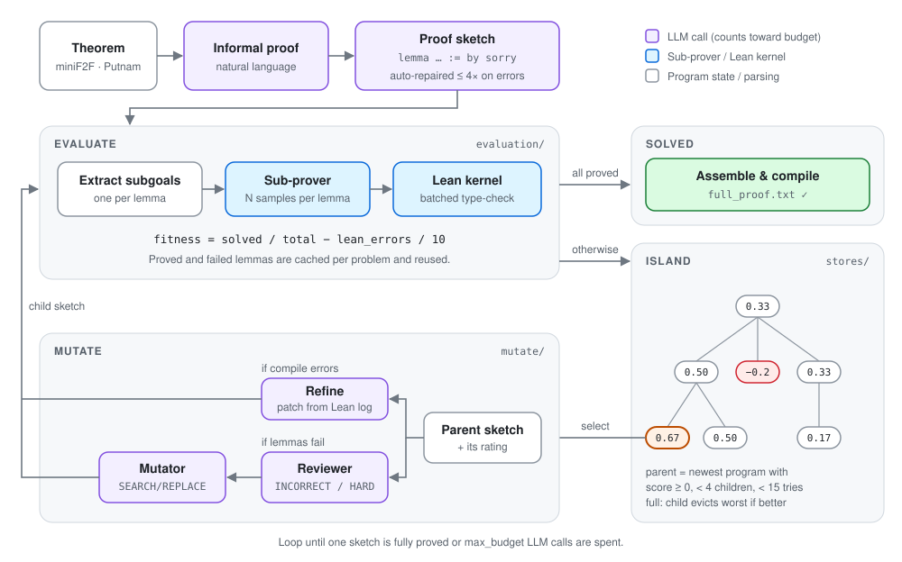

# lean_evolve

An evolutionary search system for **Lean 4 proofs** on competition-math benchmarks
(miniF2F, Putnam). Each "genome" is a Lean proof **sketch** — a skeleton in which
the main theorem is decomposed into auxiliary `lemma`s, each closed by `sorry`.
Sketches evolve over generations: a sub-prover tries to close the lemmas, an LLM
reviewer critiques failed sketches, and a mutator emits search/replace edits that
spawn a child sketch. Search is organized as an **island model**.

A run terminates when one sketch has all of its subgoals closed and the assembled
full proof compiles, or when the LLM call budget is exhausted.

<p align="center"></p>


## Results

Budget is the number of LLM calls per problem (`GLOBAL_LLM_CALLS`: informal
proof, sketch, repair, reviewer, mutator, assembly). Sub-prover samples and
Lean checks are not counted.

| Benchmark | Solved | LLM calls per solved problem |
|---|:-:|---|
| miniF2F-test subset (`data/minif2f_s1.jsonl`) | **10 / 15** | 4 – 322 |
| ↳ IMO + IMO Shortlist problems | **4 / 7** | 29, 55, 103, 322 |
| Putnam 2025 (`data/putnam_s1.jsonl`) | **2 / 3** | A1: 234, B3: 298 |

<details>
<summary>Per-problem breakdown</summary>

| Problem | Solved | LLM calls |
|---|:-:|--:|
| amc12b_2021_p3 | ✓ | 4 |
| mathd_algebra_459 | ✓ | 4 |
| induction_nfactltnexpnm1ngt3 | ✓ | 9 |
| amc12a_2020_p10 | ✓ | 13 |
| induction_sumkexp3eqsumksq | ✓ | 22 |
| imo_1963_p5 | ✓ | 29 |
| imo_1992_p1 | ✓ | 55 |
| imo_1969_p2 | ✓ | 103 |
| mathd_algebra_320 | ✓ | 141 |
| imo_1982_p1 | ✓ | 322 |
| imo_1977_p6 | ✗ | |
| imo_1997_p5 | ✗ | |
| imosl_2007_algebra_p6 | ✗ | |
| algebra_apbmpcneq0_aeq0anbeq0anceq0 | ✗ | |
| numbertheory_fxeq4powxp6powxp9powx_f2powmdvdf2pown | ✗ | |
| putnam_2025_a1 | ✓ | 234 |
| putnam_2025_b3 | ✓ | 298 |
| putnam_2025_a2 | ✗ | |

</details>


## Method

### 1. Sketch (genome)

For a target theorem, an LLM first produces an informal proof, then a formal
**sketch**: a Lean 4 file declaring auxiliary lemmas plus a top-level theorem
that consumes them. Each subgoal-lemma's body is `by sorry`; the main theorem
must compose them without `sorry`.

```lean
lemma step₁ (n : ℕ) : ... := by sorry
lemma step₂ (n : ℕ) (h : ...) : ... := by sorry
theorem target ... := by
  -- combine step₁, step₂
```

Newly generated sketches that fail to type-check are auto-repaired up to
`max_refine` (default 4) times by an LLM with the compiler errors as input.

### 2. Subgoal extraction & proving

A clean sketch is parsed into a list of subgoal lemmas
(`evaluation/extractor.py`, `lemma_style` parser).

Each subgoal is sent to an **external proof model** (`INFERENCE_URL`),
which is sampled `N_prover` times per goal. Candidates are compiled in batches by
a Lean kernel service (`Lean4Client` against `$Evaluation_url`). Successful
proofs are cached in `results/db/<problem>.json`; permanent failures in
`results/db_failure/<problem>.json` to avoid re-spending budget on them.

### 3. Fitness

```
fitness = (succeeded_subgoals / total_subgoals) − n_lean_errors / 10
```

A sketch is *correct* iff `n_lean_errors == 0` **and** there are no failed
lemmas. Once all subgoals are proved, an assembly step concatenates the
discovered proofs and compiles the full theorem.

### 4. Mutation

`RefineProgram.mutate()` (`mutate/program.py`) branches on the parent's state:

- **Has compile errors → `refine`.** Single search/replace patch driven by the
  Lean error log.
- **Clean compile but failing subgoals → `decompose_reviewer`.**
  1. A reviewer LLM tags each failed subgoal as `INCORRECT` (sketch is wrong)
     or `HARD` (sketch is right but the sub-prover can't close it).
  2. The reviewer feedback is *compressed* (drop `HARD`s if any `INCORRECT`s
     exist, else keep one `HARD`).
  3. A mutator LLM emits `>>>>SEARCH / >>>>REPLACE` edit blocks against the
     parent sketch.
  4. The patched sketch becomes a new `Program` whose parent is the original.

### 5. Population — island model

A `Database` is a folder of `Island`s; an `Island` is a folder of `Program`s
sharing one informal-proof seed. Several sampling strategies are implemented:
random, top-k, **UCB1** (the default — balances exploitation of high-scoring
programs with exploration of under-visited ones), and a "Shinka"-style
fitness-times-diversity scheme.

The current `Pipeline.run()` (`pipeline/__init__.py`) walks programs
newest-first within one island and only mutates a parent that (a) has positive
score, (b) has fewer than `max_children = 15` mutation attempts, and (c) has
fewer than 4 surviving children — a depth-greedy strategy on the mutation tree.

Capacity is enforced per island: when full, a new program evicts the worst one
only if it scores higher.

### 6. Budget

Every OpenAI call increments `GLOBAL_LLM_CALLS`. The pipeline halts when calls
reach `max_budget`. Cached subgoal proofs (and known failures) are reused across
attempts to keep the budget meaningful.


## Layout

```
lean_evolve/
├── __main__.py          # entry point: process_problem(...)
├── utils.py             # IO, Lean header, check_lean(), light Lean rewriters
├── pipeline/            # evolutionary loop
│   └── __init__.py
├── stores/              # on-disk persistence
│   ├── __init__.py      # abstract Store / Solution
│   ├── database.py      # collection of islands
│   ├── island.py        # population, sampling (UCB1, Shinka, …)
│   ├── program.py       # one sketch attempt: files, repair, assembly
│   ├── prompts.py       # informal-proof / sketch / assembly / meta prompts
│   ├── prover_store.py  # cache of {theorem → proof} per problem
│   └── utils.py
├── mutate/              # mutation operators
│   ├── __init__.py      # abstract Mutator
│   ├── program.py       # refine / decompose_reviewer / decompose_inspiration
│   └── prompts.py
├── evaluation/          # fitness pipeline
│   ├── __init__.py      # abstract Rater / Rating
│   ├── program.py       # ProgramRater: error check + extract + prove + score
│   ├── extractor.py     # parse sketch into per-lemma subgoals
│   ├── prover.py        # call external prover, verify, cache
│   ├── verifier.py      # batched LeanVerifier client
│   ├── lean_utils.py    # signature/comment/sorry surgery, sketch error check
│   └── prompts.py       # extract / repair / reviewer / hint prompts
└── models/
    └── llm_utils.py     # OpenAI wrapper + GLOBAL_LLM_CALLS counter
```


## Running

```bash
python -m lean_evolve
```

`__main__.py` is currently hard-coded to one problem; edit the bottom of the
file to select a different miniF2F / Putnam problem and an output directory
under `results/`. Per-problem state (sketches, ratings, subgoal proofs,
mutation history) is written to
`results/<Population>/<problem_name>/island_<i>/program_<j>/`.

### Environment variables

| Var               | Used for                                     |
|-------------------|----------------------------------------------|
| `OPEN_AI_KEY`     | OpenAI completions (sketch / refine / review / mutate) |
| `INFERENCE_URL`   | External Lean proof model for subgoal-proving |
| `Evaluation_url`  | `Lean4Client` Lean kernel verifier service   |

### External dependencies

- `client.client.Lean4Client` — Lean compile/verify service (sibling repo).
- An inference server that accepts `{inputs: [...], pass_n: N}` and returns
  `N` candidate continuations per input.
- OpenAI Python SDK (models `gpt-5-mini`, `gpt-5.2`).


## Outputs

A successful problem produces:

- `results/.../program_*/sketch.txt` — the winning sketch.
- `results/.../program_*/eval/succeeded_proofs.json` — proofs of every subgoal.
- `results/.../program_*/full_proof.txt` — assembled, type-checked Lean file.
- A copy of the final `.lean` file at the path configured in
  `utils.lean_project_path`.
